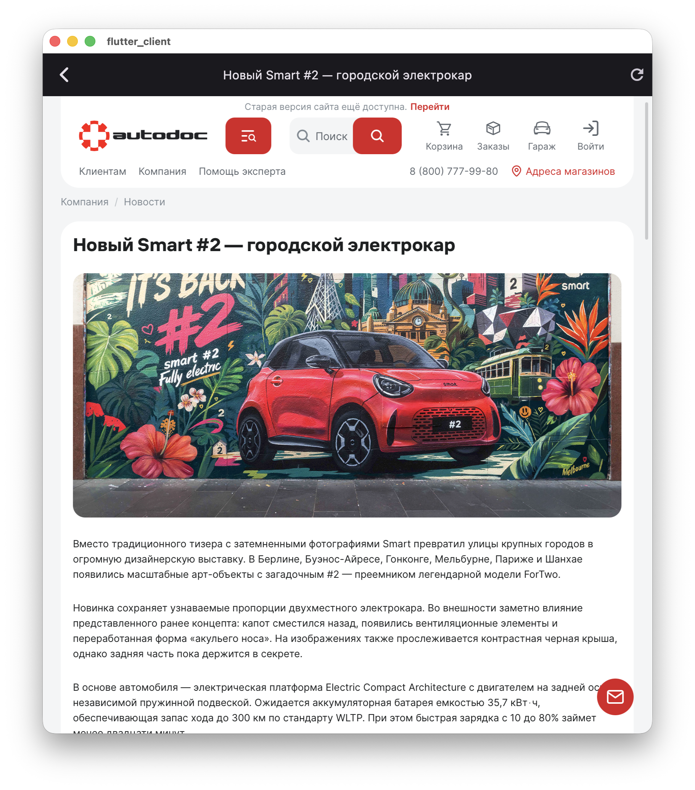

# Клиентское приложение новостей

<p align="center">
  <details>
    <summary><b>📱 Посмотреть скриншоты приложения</b></summary>
    <br>
    <br><br>
    
  </details>
</p>

Легковесное и отзывчивое приложение на Flutter. Вся бизнес-логика, асинхронная сеть и интерфейс написаны на **Dart**.

Приложение состоит из двух основных экранов:
* **Страница со списком новостей** — отображает ленту актуальных событий в виде плиточных карточек с поддержкой пагинации.
* **Страница отображения новости** — открывает полный контент выбранной статьи во встроенном WebView для точного рендеринга оригинального сайта.

---

## 🏗 Архитектура и структура проекта

Проект работает на стандартной монолитной структуре Flutter-приложения. Весь исходный код находится непосредственно в корневой директории репозитория:

* **`lib/models/`** — Слой данных. Содержит модель `NewsItem` с честной опциональностью (Null Safety) для безопасного парсинга сырого JSON.
* **`lib/services/`** — Сетевой слой. Асинхронный HTTP-клиент на базе **Dio**, отвечающий за взаимодействие с REST API.
* **`lib/screens/`** — Слой интерфейса. 
  * Экран списка новостей со встроенной бесшовной пагинацией, динамически вычисляющей сдвиг (`offset`) на основе размера текущего списка.
  * Экран просмотра новости с интегрированным WebView-компонентом для интеграции внешнего веб-контента.
* **`lib/widgets/`** — Переиспользуемые UI-компоненты (плиточная карточка новости с умным кэшированием изображений).

---

## 🛠 Технологический стек

* **Фреймворк:** Flutter 3.47+ (Dart SDK ^3.13.5)
* **Сетевой клиент:** Dio 5.7.0 (асинхронные сокеты, пулинг потоков, кастомные таймауты)
* **Просмотр контента:** webview_all (встроенное отображение веб-страниц внутри приложения)
* **Работа с медиа:** CachedNetworkImage 3.4.1 (кэширование картинок)
* **Линтер:** flutter_lints 6.0.0 (строгий статический анализ кода)

---

## 🚀 Инструкция по быстрому запуску проекта

Сборка выполняется в несколько простых команд напрямую из корня репозитория:

### Шаг 1: Восстановление нативных конфигураций (при необходимости)
Если вы запускаете проект на новой машине или хотите обновить файлы платформ, сгенерируйте системные каталоги:
```bash
flutter create --platforms=macos .
```

### Шаг 2: Установка зависимостей Dart
Подтяните актуальные версии пакетов:
```bash
flutter pub get
```

### Шаг 3: Сброс кэша сборщика и запуск
Полностью очистите внутренние временные файлы сборки Flutter и запустите приложение на вашей целевой платформе:
```bash
flutter clean
flutter pub get
```
```bash
flutter run -d macos
```
